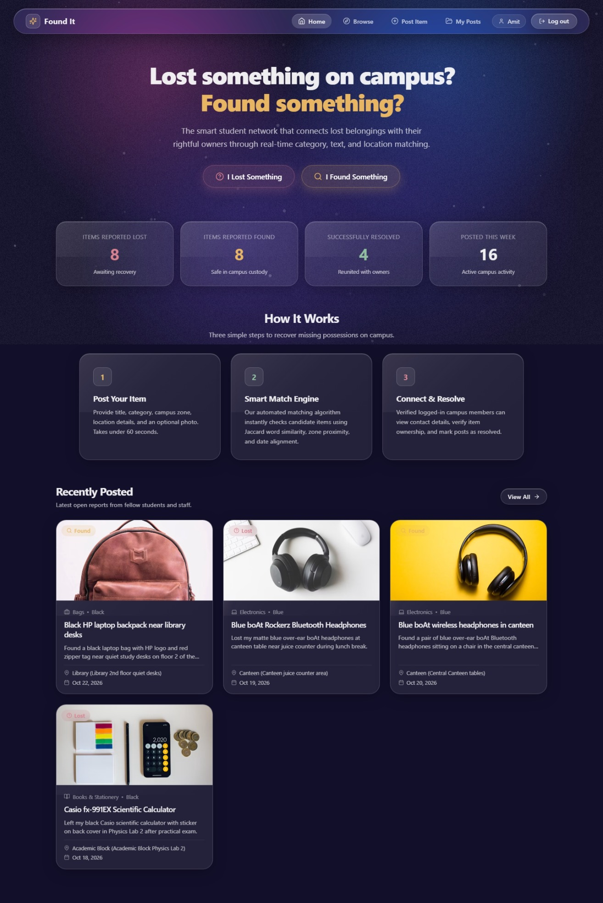
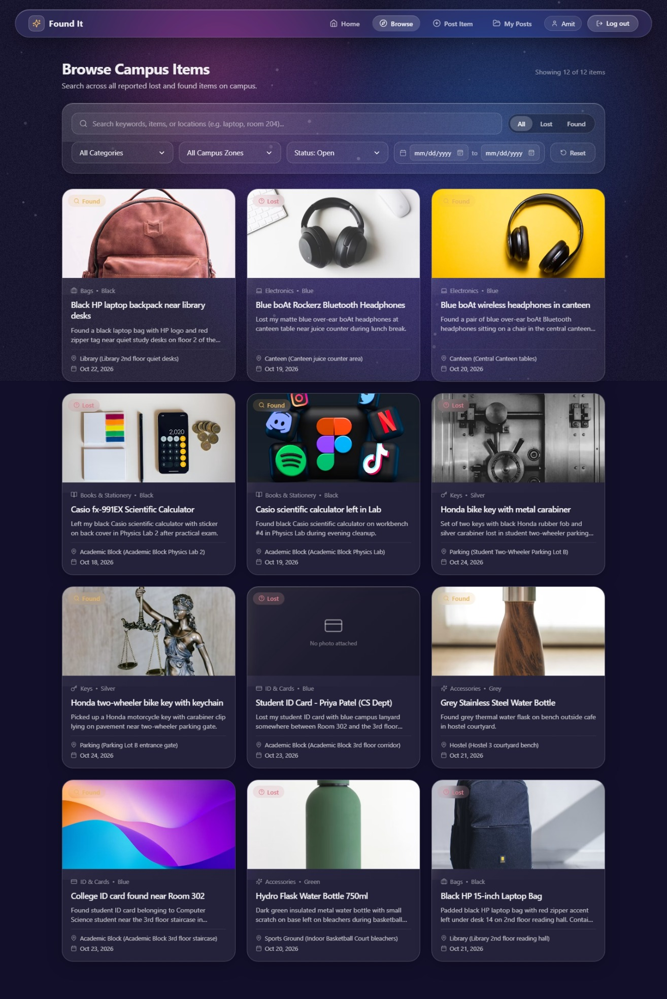
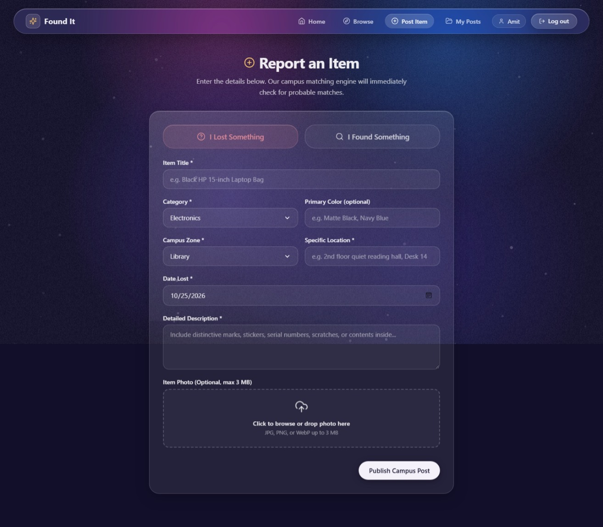
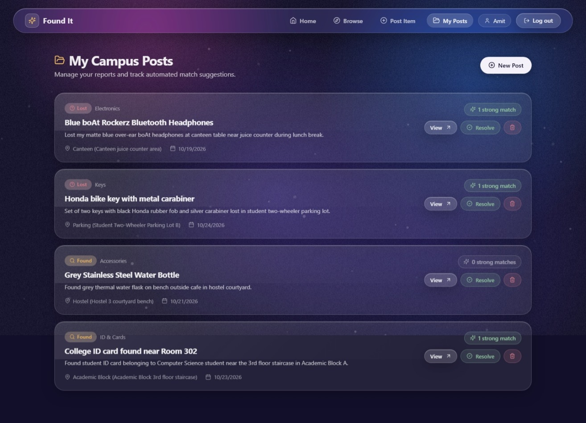
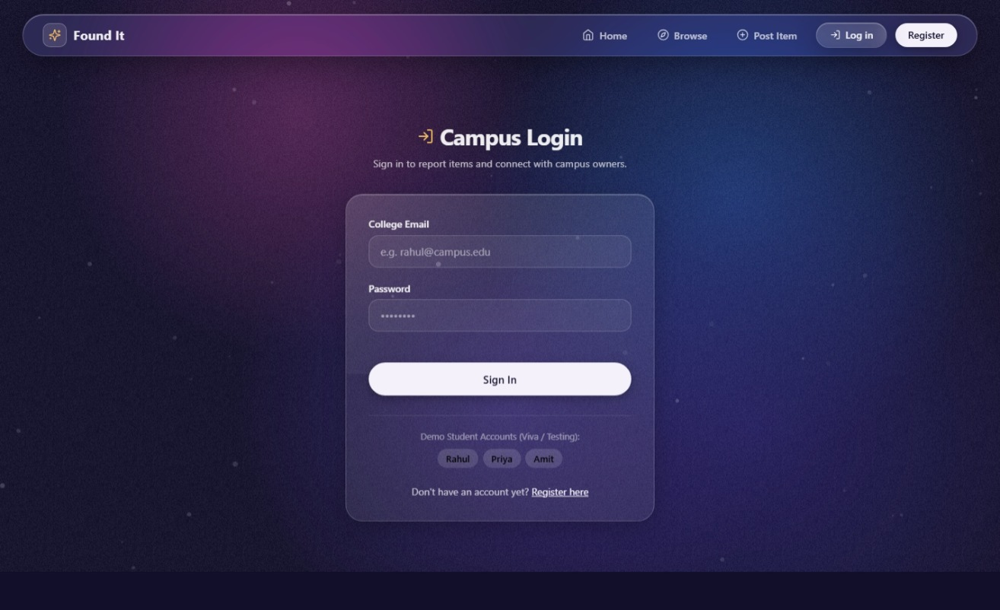
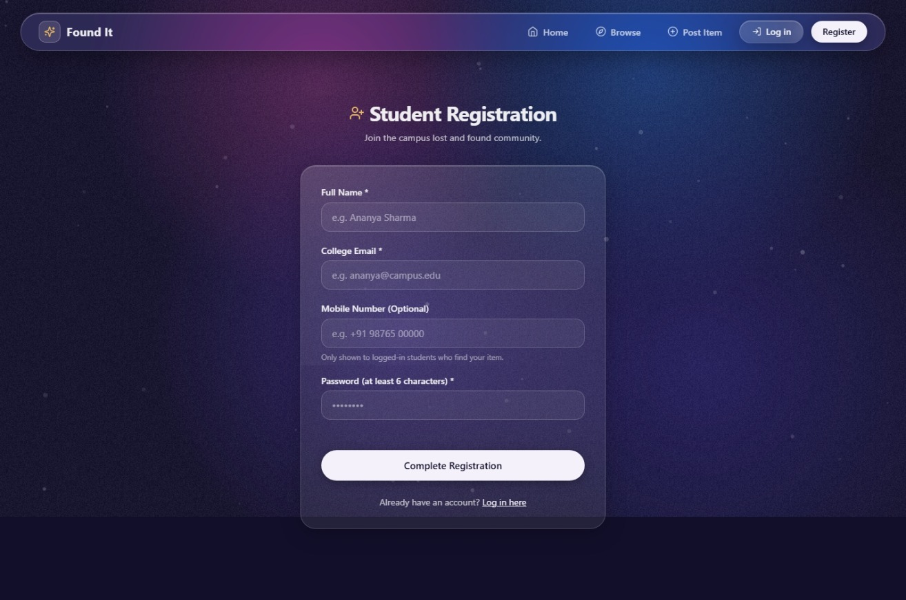

# Found It — Campus Lost & Found Community Portal

A full-stack, responsive web application engineered for college campuses to enable students and faculty to report, track, and recover lost and found personal belongings. The system incorporates an automated similarity matching algorithm that computes multi-factor compatibility scores between lost and found posts to accelerate reconnection between finders and owners.

---

## Screenshots

### 1. Home Page (Hero, Live Statistics & Workflow)

*Landing interface showing real-time campus statistics and the core 3-step recovery guide.*

### 2. Browse Catalog (Search, Faceted Filters & Pagination)

*Filterable catalog supporting keyword search, type toggles (All / Lost / Found), categories, campus zones, and date ranges.*

### 3. Report an Item (Submission Form & Image Upload)

*Form for reporting lost or found items with location details, date picker, and client-validated photo upload.*

### 4. User Dashboard: My Posts (Match Alerts & Quick Actions)

*Personal control center showing active submissions, automated strong-match count indicators (score >= 50%), and resolution tools.*

### 5. Campus Authentication (Student Login & Demo Access)

*Student portal sign-in with quick-fill credentials for demonstration and viva testing.*

### 6. Student Registration (Account Creation)

*New student registration form with name, college email, password validation, and optional contact number.*

---

## Core Features

- **Automated Similarity Matching Engine:** Evaluates active opposite-type reports using category comparison, keyword Jaccard token similarity, color correlation, campus zone proximity, and chronological closeness to generate scored match suggestions with transparent rationales.
- **Aurora Glassmorphism Interface:** Designed in custom CSS without external UI frameworks. Features an interactive HTML5 Canvas background with drifting light pools that smoothly ease toward pointer and touch coordinates, paired with frosted glass cards, subtle light sheen reflections, and floating bokeh specks.
- **Privacy-Preserving Contact Verification:** Item listings are publicly viewable by the campus community, but finder and owner contact information (email address and phone number) is restricted to authenticated logged-in students.
- **Real-Time Campus Statistics:** Aggregated counts for total items reported lost, total found items, successfully resolved reunions, and items posted within the last 7 days.
- **User Management Dashboard:** Dedicated "My Posts" panel allowing students to monitor match indicators, edit report specifications, mark items as resolved, or permanently remove listings.

---

## Technology Stack

| Layer | Technologies |
| :--- | :--- |
| **Frontend Framework** | React 18 with Vite build tooling |
| **Language** | Plain JavaScript (ECMAScript 2022+ / ES Modules) |
| **Styling** | Vanilla CSS3 (Custom Design System, Glassmorphism, CSS Custom Properties) |
| **Routing & Icons** | `react-router-dom` (v6), `lucide-react` |
| **HTTP Client** | `axios` (with JWT request interceptors and automatic 401 session handling) |
| **Backend Runtime** | Node.js with Express.js |
| **Database** | MongoDB with Mongoose ODM (indexing, full-text search) |
| **Authentication** | JSON Web Tokens (`jsonwebtoken`), Password Hashing with salt rounds (`bcryptjs`) |
| **File Handling** | `multer` (disk storage with validation for JPG, PNG, and WebP up to 3 MB) |
| **Development Utility**| `concurrently` (unified single-command server and client orchestration) |

---

## Project Structure

```text
25070521309-CA-03/
├── .gitignore                # Excludes node_modules, build outputs, and local files
├── package.json              # Root scripts: install:all, dev, seed
├── README.md                 # Complete documentation and setup guide
├── screenshots/              # Application preview screenshots for README
├── server/
│   ├── package.json          # Server dependencies and lifecycle scripts
│   ├── .env.example          # Template for backend environment variables
│   ├── .env                  # Backend configuration (PORT, MONGO_URI, JWT_SECRET)
│   ├── server.js             # Express application configuration and error middleware
│   ├── config/
│   │   └── db.js             # MongoDB connection configuration (127.0.0.1)
│   ├── models/
│   │   ├── User.js           # Student schema (name, email, passwordHash, phone)
│   │   └── Item.js           # Item schema (type, category, zone, dates, status, indexes)
│   ├── middleware/
│   │   ├── auth.js           # JWT authentication (protect & optionalAuth)
│   │   └── upload.js         # Multer configuration for file uploads
│   ├── routes/
│   │   ├── authRoutes.js     # Routes for /api/auth
│   │   ├── itemRoutes.js     # Routes for /api/items
│   │   └── statsRoutes.js    # Routes for /api/stats
│   ├── controllers/
│   │   ├── authController.js # Handlers for login, register, and profile retrieval
│   │   ├── itemController.js # CRUD handlers, filtering, pagination, and ownership checks
│   │   └── statsController.js# Aggregated statistics handlers
│   ├── utils/
│   │   └── matcher.js        # Pure similarity scoring function
│   ├── seed/
│   │   └── seed.js           # Database seeder (3 demo students, 14 realistic items)
│   └── uploads/
│       └── .gitkeep          # Upload directory anchor
└── client/
    ├── package.json          # Frontend dependencies and build scripts
    ├── vite.config.js        # Vite proxy configuration for /api and /uploads
    ├── index.html            # Application entry point with metadata
    ├── src/
    │   ├── main.jsx          # Root React renderer with Context Providers and Router
    │   ├── App.jsx           # Application routing layout
    │   ├── api/
    │   │   └── axios.js      # Configured Axios instance with JWT interceptor
    │   ├── context/
    │   │   ├── AuthContext.jsx # Authentication state, login, and registration methods
    │   │   └── ToastContext.jsx# Notification toast dispatch system
    │   ├── components/
    │   │   ├── GradientBackground.jsx # Full-screen interactive canvas background
    │   │   ├── Navbar.jsx    # Floating glass dock header
    │   │   ├── GlassCard.jsx # Reusable glass container component
    │   │   ├── ItemCard.jsx  # Grid catalog item component with fallback icons
    │   │   ├── ItemForm.jsx  # Reusable submission form with live image preview
    │   │   ├── FilterBar.jsx # Multi-facet search and filter bar
    │   │   ├── MatchList.jsx # Scored match list with indicator rings and reasons
    │   │   ├── StatusBadge.jsx# Status indicators (Lost, Found, Resolved)
    │   │   ├── Toast.jsx     # Global notification popups
    │   │   ├── Skeleton.jsx  # Loading placeholders for grid and detail views
    │   │   ├── EmptyState.jsx# Fallback display for empty query results
    │   │   └── ProtectedRoute.jsx # Route authentication guard
    │   ├── pages/
    │   │   ├── Home.jsx      # Landing page with stats and recent reports
    │   │   ├── Browse.jsx    # Search and filtering catalog
    │   │   ├── PostItem.jsx  # Item reporting interface
    │   │   ├── ItemDetail.jsx# Full details, contacts, owner actions, and matches
    │   │   ├── MyPosts.jsx   # User dashboard with strong-match indicators
    │   │   ├── Login.jsx     # Student login with quick-fill demo buttons
    │   │   ├── Register.jsx  # Student registration form
    │   │   └── NotFound.jsx  # 404 error page
    │   └── styles/
    │       ├── variables.css # Color tokens and design variables
    │       ├── global.css    # Typography, button utilities, layout resets
    │       ├── glass.css     # Glassmorphism effects and backdrop filters
    │       └── components.css# Component-level styling and responsive layout rules
```

---

## Similarity Matching Algorithm

Located in [`server/utils/matcher.js`](file:///c:/Users/VICTUS/Desktop/Projects/campus-lost-and-found/server/utils/matcher.js), the scoring engine evaluates a target item against all open candidate items of the opposite type (`lost` versus `found`). The algorithm produces a similarity score from **0 to 100 points**:

```text
Total Score (100 Points Max) = 
  Category Match (30 pts) + 
  Keyword Text Similarity (up to 35 pts) + 
  Color Match (10 pts) + 
  Campus Zone & Location Overlap (up to 15 pts) + 
  Date Proximity (up to 10 pts)
```

1. **Category Match (30 Points):**
   Exact match between item categories (e.g., `Electronics` === `Electronics`).
   - Rationale: `"Same category (<Category>)"`

2. **Text Similarity (Up to 35 Points):**
   Title and description strings are normalized, punctuation removed, and common stop words stripped. The engine then calculates the Jaccard similarity coefficient between keyword sets:
   $$\text{Jaccard}(A, B) = \frac{|A \cap B|}{|A \cup B|}$$
   The resulting ratio is scaled by 35 to assign keyword points.
   - Rationale: `"Matching keywords: <matched tokens>"`

3. **Color Matching (10 Points):**
   Applied when color attributes are defined on both items. Evaluates exact or substring matches (e.g., "blue" within "navy blue").
   - Rationale: `"Matching color (<Color>)"`

4. **Campus Zone and Location Overlap (Up to 15 Points):**
   - Matching `campusZone` awards 10 points.
   - Overlapping keywords in `locationName` (e.g., "Library 2nd floor") award an additional 5 points (capped at 15 points total for the location block).
   - Rationales: `"Same campus zone (<Zone>)"`, `"Specific location overlap"`

5. **Date Proximity (Up to 10 Points):**
   Chronological ordering requires the found date to be on or after the lost date (with a 24-hour buffer for reporting variance).
   - Within 3 days: **10 points**
   - Within 7 days: **5 points**
   - Rationales: `"Dates within 3 days"`, `"Dates within a week"`

**Threshold:** Only candidate items with a total score of **30 points or higher** are returned, ranked in descending order (top 5).

---

## API Reference

All endpoints return standard JSON responses and are prefixed with `/api`.

### Authentication Endpoints (`/api/auth`)
| Method | Endpoint | Access | Description |
| :--- | :--- | :--- | :--- |
| `POST` | `/api/auth/register` | Public | Register a student account (`name`, `email`, `password`, `phone`) |
| `POST` | `/api/auth/login` | Public | Authenticate student and receive a JWT token |
| `GET` | `/api/auth/me` | Private | Retrieve current authenticated user profile |

### Item Endpoints (`/api/items`)
| Method | Endpoint | Access | Description |
| :--- | :--- | :--- | :--- |
| `GET` | `/api/items` | Public | Filterable catalog. Parameters: `type`, `category`, `campusZone`, `status`, `q`, `from`, `to`, `page`, `limit` |
| `GET` | `/api/items/mine` | Private | Retrieve logged-in student's posts with calculated strong-match counts (score >= 50%) |
| `GET` | `/api/items/:id` | Public | Retrieve item details. Contact info (email, phone) is populated only if requester is logged in |
| `POST` | `/api/items` | Private | Create a lost or found report with optional multipart image upload (max 3 MB) |
| `PUT` | `/api/items/:id` | Private (Owner) | Modify an existing item post and optionally update photo |
| `DELETE`| `/api/items/:id` | Private (Owner) | Delete an item post and unlink image file from disk |
| `PATCH`| `/api/items/:id/resolve` | Private (Owner) | Mark an item's status as resolved |
| `GET` | `/api/items/:id/matches`| Public | Retrieve top 5 scored opposite-type matches with rationales |

### Statistics Endpoints (`/api/stats`)
| Method | Endpoint | Access | Description |
| :--- | :--- | :--- | :--- |
| `GET` | `/api/stats` | Public | Returns aggregated counts: `totalLost`, `totalFound`, `totalResolved`, `itemsThisWeek` |

---

## Setup and Installation Instructions

Follow these steps to set up and run the application locally on your machine.

### Prerequisites
1. **Node.js**: Version 18.x or 20.x LTS installed. Verify in your terminal:
   ```bash
   node -v
   npm -v
   ```
2. **MongoDB**: Ensure MongoDB Community Server is installed and running locally on port `27017`.
   - Default URI used: `mongodb://127.0.0.1:27017/campus_lost_found`
   - You can verify the database connection using [MongoDB Compass](https://www.mongodb.com/products/tools/compass).

---

### Step-by-Step Guide After Cloning

#### 1. Clone the Repository
```bash
git clone https://github.com/your-username/campus-lost-and-found.git
cd campus-lost-and-found
```

#### 2. Install All Dependencies
Install dependencies for the root orchestrator, backend server, and frontend client with a single command:
```bash
npm run install:all
```

#### 3. Verify Environment Configuration
A default configuration file is provided at `server/.env`. If you need custom settings, ensure `server/.env` contains:
```env
PORT=5000
MONGO_URI=mongodb://127.0.0.1:27017/campus_lost_found
JWT_SECRET=campus_lost_found_jwt_secret_key_2024
```

#### 4. Seed the Database
Populate the database with demo student accounts and realistic campus items:
```bash
npm run seed
```
This script wipes any existing development data, creates 3 verified student accounts, and inserts 14 realistic campus items featuring 5 intentional high-scoring match pairs.

#### 5. Start the Application
Start both the Express backend API and the Vite frontend dev server concurrently:
```bash
npm run dev
```

Once running:
- **Client Application:** Open [http://127.0.0.1:5173](http://127.0.0.1:5173) in your browser.
- **Backend API:** Available at [http://127.0.0.1:5000/api](http://127.0.0.1:5000/api).

---

## Demo Student Accounts (For Testing & Viva Evaluation)

All seeded accounts share the same password for testing convenience:

| Full Name | Email Address | Password | Contact Number |
| :--- | :--- | :--- | :--- |
| **Rahul Sharma** | `rahul@campus.edu` | `Demo@123` | `+91 98765 43210` |
| **Priya Patel** | `priya@campus.edu` | `Demo@123` | `+91 98765 43211` |
| **Amit Verma** | `amit@campus.edu` | `Demo@123` | `+91 98765 43212` |

> **Note:** The Login page includes 1-click credential auto-fill buttons for each of these test accounts.

### Pre-Configured Match Demonstration Pairs:
1. **HP Laptop Bag:** Lost by Rahul (Library, Bags, Black) matches Found by Priya (Library, Bags, Black) with an ~85% score.
2. **boAt Headphones:** Lost by Amit (Canteen, Electronics, Blue) matches Found by Rahul (Canteen, Electronics, Blue) with an ~80% score.
3. **Student ID Card:** Lost by Priya (Academic Block, ID & Cards, Blue) matches Found by Amit (Academic Block, ID & Cards, Blue) with a ~75% score.
4. **Casio Calculator:** Lost by Rahul (Academic Block, Books & Stationery, Black) matches Found by Priya (Academic Block, Books & Stationery, Black) with an ~80% score.
5. **Honda Bike Key:** Lost by Amit (Parking, Keys, Silver) matches Found by Rahul (Parking, Keys, Silver) with an ~80% score.

---

## License

This project is developed for educational and academic demonstration purposes.
